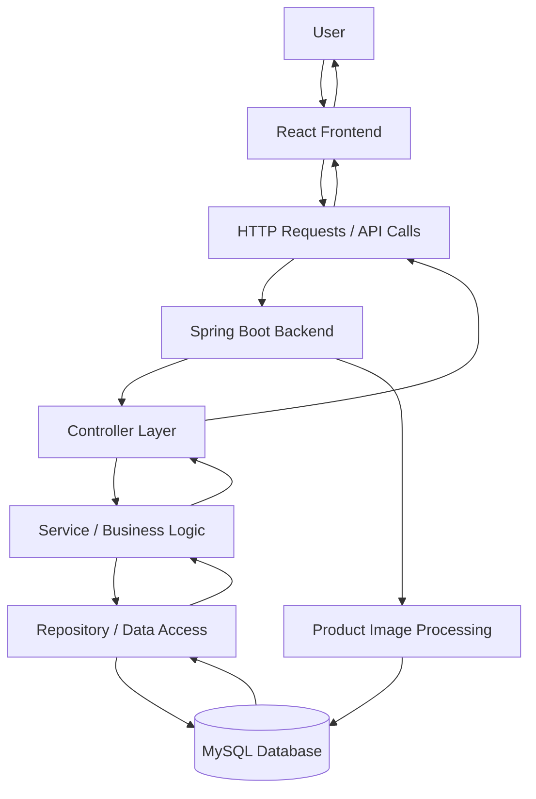

# 🛒 E-Com Fullstack — Modern E-Commerce Web Application 

<p align="center">
  
  
  
  
  
</p>

<p align="center">
  A full-stack e-commerce application built with Spring Boot, React, and MySQL, featuring product management, image uploads, dynamic product search, and inventory-aware shopping interactions.
</p>

<p align="center">
  <a href="https://github.com/Rashmiranjan07/E-Com-fullstack"><strong>Explore Repository</strong></a>
  ·
  <a href="https://github.com/Rashmiranjan07/E-Com-fullstack/issues">Report an Issue</a>
  ·
  <a href="https://github.com/Rashmiranjan07">Developer Profile</a>
</p>

---

## 📌 Table of Contents

- [Overview](#-overview)
- [Features](#-key-features)
- [Tech Stack](#-tech-stack)
- [Application Architecture](#-application-architecture)
- [Project Structure](#-project-structure)
- [Getting Started](#-getting-started)
- [Environment Configuration](#-environment-configuration)
- [How It Works](#-how-it-works)
- [API Overview](#-api-overview)
- [Screenshots](#-screenshots)
- [Future Improvements](#-future-improvements)
- [Learning Outcomes](#-learning-outcomes)
- [Contributing](#-contributing)
- [Author](#-author)
- [License](#-license)

---

## 🚀 Overview

**E-Com Fullstack** is a full-stack e-commerce web application designed to demonstrate how a modern frontend, a Java-based backend, and a relational database work together to deliver a dynamic shopping experience.

The application combines a React user interface with REST-style backend services built using Spring Boot. MySQL is used for persistent data storage, while the backend handles product operations, search functionality, and product image processing.

The project focuses on practical full-stack development concepts, including API integration, database persistence, CRUD operations, file uploads, and frontend state management.

### 🎯 Project Goals

- Build a functional full-stack web application.
- Develop backend services using Java and Spring Boot.
- Create an interactive frontend using React.
- Integrate MySQL for persistent product data.
- Implement product search and image handling.
- Understand communication between frontend and backend applications.

---

## ✨ Key Features

### 📦 Product Management
- Create new product records.
- Retrieve and display product information.
- Update existing product details.
- Delete products when required.
- Maintain product information in the database.

### 🔍 Smart Product Search
- Search products using keywords.
- Search across product names, descriptions, brands, and categories.
- Retrieve matching products through backend queries.

### 🖼️ Product Image Management
- Upload product images using multipart form data.
- Process image uploads alongside product metadata.
- Store image data in the database.
- Retrieve and serve images through backend endpoints.
- Handle image content types dynamically.

### 🛍️ Shopping Interactions
- Display product availability based on stock quantity.
- Reflect inventory state in the user interface.
- Enable or restrict cart interactions according to product availability.

### ⚡ Full-Stack Integration
- Connect the React frontend with Spring Boot APIs.
- Persist application data using MySQL.
- Organize the frontend and backend into separate directories.
- Use Maven to manage backend dependencies and builds.

---

## 🧰 Tech Stack

<table>
  <thead>
    <tr>
      <th>Technology</th>
      <th>Purpose</th>
    </tr>
  </thead>
  <tbody>
    <tr>
      <td><strong>Java</strong></td>
      <td>Backend programming language</td>
    </tr>
    <tr>
      <td><strong>Spring Boot</strong></td>
      <td>Backend application and API development</td>
    </tr>
    <tr>
      <td><strong>Spring Data JPA / Hibernate</strong></td>
      <td>Database persistence and ORM, where configured</td>
    </tr>
    <tr>
      <td><strong>MySQL</strong></td>
      <td>Relational database</td>
    </tr>
    <tr>
      <td><strong>React</strong></td>
      <td>Frontend user interface</td>
    </tr>
    <tr>
      <td><strong>JavaScript</strong></td>
      <td>Frontend logic and interactions</td>
    </tr>
    <tr>
      <td><strong>HTML5 & CSS3</strong></td>
      <td>Application structure and styling</td>
    </tr>
    <tr>
      <td><strong>Apache Maven</strong></td>
      <td>Backend dependency and build management</td>
    </tr>
    <tr>
      <td><strong>Git & GitHub</strong></td>
      <td>Version control and source code management</td>
    </tr>
  </tbody>
</table>

---

## 🏗️ Application Architecture

The application follows a frontend-backend-database architecture.



### 🔄 Request Flow

1. The user interacts with the React interface.
2. The frontend sends a request to the backend.
3. Spring Boot processes the incoming request.
4. Backend logic performs the required operation.
5. The data-access layer communicates with MySQL.
6. The backend returns a response.
7. React updates the interface with the result.

This separation makes the application easier to understand, maintain, debug, and extend.

---

## 📁 Project Structure

```text
E-Com-fullstack/
│
├── backend/
│   ├── src/
│   │   └── main/
│   │       ├── java/
│   │       │   └── ...                  # Spring Boot source code
│   │       └── resources/
│   │           └── application.properties
│   │
│   ├── pom.xml                          # Maven configuration
│   └── ...
│
├── frontend/
│   ├── public/
│   ├── src/
│   │   ├── components/                  # UI components and pages
│   │   ├── Context/                     # Shared application state
│   │   └── App.jsx                      # Main application component
│   │
│   ├── package.json
│   └── ...
│
├── .gitignore
└── README.md
```

*Note: The structure above is a simplified overview. Refer to the repository for the complete source code and actual package names.*

---

## ⚙️ Getting Started

Follow these steps to run the project locally.

### 1. Prerequisites

Install the following tools before getting started:

- **Java JDK** — compatible with the version configured in the backend.
- **Apache Maven** — for building and running the backend.
- **Node.js and npm** — for running the React frontend.
- **MySQL Server** — for database storage.
- **Git** — for cloning the repository.
- A code editor or IDE, such as Eclipse, IntelliJ IDEA, or VS Code.

Verify your installations:

```bash
java -version
mvn -version
node -v
npm -v
git --version
```

### 2. Clone the Repository

```bash
git clone https://github.com/Rashmiranjan07/E-Com-fullstack.git
```

Navigate into the project:

```bash
cd E-Com-fullstack
```

### 3. Configure the Database

Start MySQL and create the database used by your application.

Example:

```sql
CREATE DATABASE ecommerce_db;
```

Use the database name, table configuration, and credentials expected by your backend.

### 4. Configure the Backend

Navigate to the backend directory:

```bash
cd backend
```

Open `src/main/resources/application.properties` and configure the database connection.

Example configuration:

```properties
spring.datasource.url=jdbc:mysql://localhost:3306/ecommerce_db
spring.datasource.username=${DB_USERNAME}
spring.datasource.password=${DB_PASSWORD}

# Set this according to the project's existing JPA configuration.
spring.jpa.hibernate.ddl-auto=update
```

Make sure the MySQL driver and other required dependencies are present in `pom.xml`.

**Important:** The example assumes the database is named `ecommerce_db`. Change it to match your actual configuration. Set `DB_USERNAME` and `DB_PASSWORD` in your environment, or use the configuration method already implemented by your application. Never commit real database credentials to GitHub.

### 5. Run the Backend

From the `backend` directory, execute:

```bash
mvn clean install
```

Then start the application:

```bash
mvn spring-boot:run
```

Wait until Spring Boot starts successfully.

> The backend port depends on your application configuration. Check `server.port` in `application.properties`; Spring Boot commonly defaults to port `8080`.

### 6. Run the Frontend

Open a second terminal and navigate to the frontend directory from the project root:

```bash
cd frontend
```

Install the required dependencies:

```bash
npm install
```

Start the development server:

```bash
npm run dev
```

If your `package.json` uses a different start script, run the corresponding command instead.

Open the local URL printed in your terminal to access the frontend.

### 7. Verify the Application

- Confirm that the frontend loads successfully.
- Confirm that the backend starts without errors.
- Verify that the backend connects to MySQL.
- Test product creation, viewing, updating, and deletion.
- Test product search and image upload/retrieval.
- Verify that frontend API requests target the correct backend URL.

---

## 🔐 Environment Configuration

Keep sensitive configuration outside version control.

Typical environment variables include:

| Variable | Purpose |
|---|---|
| `DB_USERNAME` | MySQL username |
| `DB_PASSWORD` | MySQL password |
| `VITE_API_BASE_URL` | Optional frontend API base URL, if the application is configured to use it |

These names are examples, not a guarantee that the project currently reads them. Configure the application to use the relevant variables before relying on them.

For local development, use environment variables or an ignored local configuration file. Never publish database passwords, API keys, or other secrets in source control.

---

## 🔌 API Overview

The backend exposes product-related operations for the frontend.

| Operation | HTTP method | Purpose |
|---|---|---|
| Create product | `POST` | Add a product |
| Get products | `GET` | Retrieve product information |
| Get product by ID | `GET` | Retrieve a specific product |
| Update product | `PUT` or `PATCH` | Modify product information |
| Delete product | `DELETE` | Remove a product |
| Search products | `GET` | Find matching products |
| Upload product image | `POST` | Upload product image data |
| Retrieve product image | `GET` | Fetch stored image content |

**Endpoint note:** These are logical operation categories, not verified route paths. The actual HTTP methods, URLs, request parameters, and payload formats depend on the controllers implemented in the backend. Check the source code before using them in API clients.

### Example: Product JSON

A typical product payload might look like this:

```json
{
  "name": "Wireless Headphones",
  "brand": "Example Brand",
  "description": "Wireless headphones for everyday use",
  "category": "Electronics",
  "price": 2499.00,
  "stockQuantity": 25
}
```

This is an illustrative example. Adapt the field names and data types to your actual product model.

### Image Upload

Product image uploads typically use `multipart/form-data`, allowing the client to send image content and associated product information to the backend.

The backend processes the uploaded file and makes the stored image available through its configured image-retrieval endpoint.

---

## 📸 Screenshots

Add screenshots of your actual application to showcase the user interface and functionality.

Create a `screenshots/` directory in the repository and add images such as:

- `home-page.png` — Main product listing page
- `product-details.png` — Product details
- `add-product.png` — Product creation form
- `search-results.png` — Product search results

Once the files exist, display them in this section:

```markdown
<p align="center">
  
</p>

<p align="center">
  
</p>
```

Replace these example filenames with your actual screenshots. Do not include placeholder images as though they were real application screenshots.

---

## 🚧 Future Improvements

Potential enhancements for future versions include:

- [ ] User registration and authentication.
- [ ] Role-based access control for administrators and customers.
- [ ] JWT-based authentication and authorization.
- [ ] Shopping cart persistence and checkout workflow.
- [ ] Order management and order history.
- [ ] Payment gateway integration.
- [ ] Product reviews and ratings.
- [ ] Pagination, sorting, and advanced filtering.
- [ ] Improved validation and centralized exception handling.
- [ ] Unit and integration testing.
- [ ] Docker-based development environment.
- [ ] Cloud deployment and automated CI/CD.

These items represent possible future work and are not claims that the features are already implemented.

---

## 📚 Learning Outcomes

This project provides practical experience with:

- Full-stack application development.
- Java and Spring Boot backend development.
- REST API design and frontend integration.
- React components and shared state management.
- MySQL database connectivity and persistence.
- CRUD operations and search queries.
- Multipart file uploads and image retrieval.
- Maven dependency management.
- Git, GitHub, debugging, and application configuration.

---

## 🤝 Contributing

Contributions, suggestions, and constructive feedback are welcome.

To contribute:

1. Fork the repository.
2. Create a new branch.

   ```bash
   git checkout -b feature/your-feature
   ```

3. Make your changes and test them.
4. Commit your changes.

   ```bash
   git add .
   git commit -m "Add your feature"
   ```

5. Push your branch.

   ```bash
   git push origin feature/your-feature
   ```

6. Open a Pull Request describing your changes.

Please keep contributions focused, follow the existing project structure, and avoid committing secrets or generated files.

---

## 👨‍💻 Author

**Rashmiranjan Shaw**

Java Full-Stack Developer | Computer Science Engineering Student

<p align="left">
  <a href="https://github.com/Rashmiranjan07">
    
  </a>
  <a href="https://rashmiranjan07.github.io/Portfolio/">
    
  </a>
  <a href="https://www.linkedin.com/">
    
  </a>
</p>

Explore more projects on my [GitHub profile](https://github.com/Rashmiranjan07).

---

## 📄 License

No license information has been verified for this repository. If you intend to distribute the project as open source, choose an appropriate license and add its license file before describing the project as licensed.

---

<p align="center">
  <strong>Built with ☕ Java, ⚛️ React, and ❤️ a passion for full-stack development.</strong>
</p>

<p align="center">
  ⭐ If you find this project interesting, consider starring the repository!
</p>
